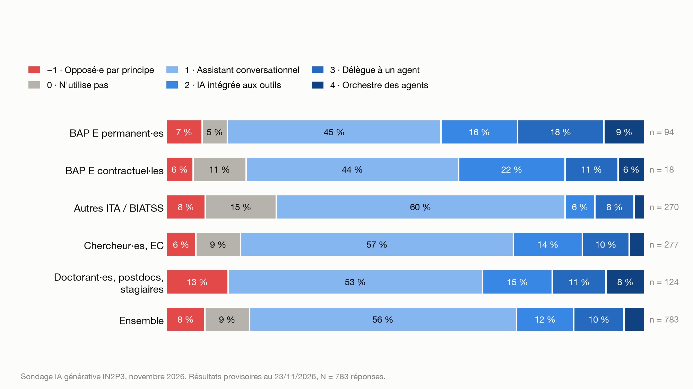
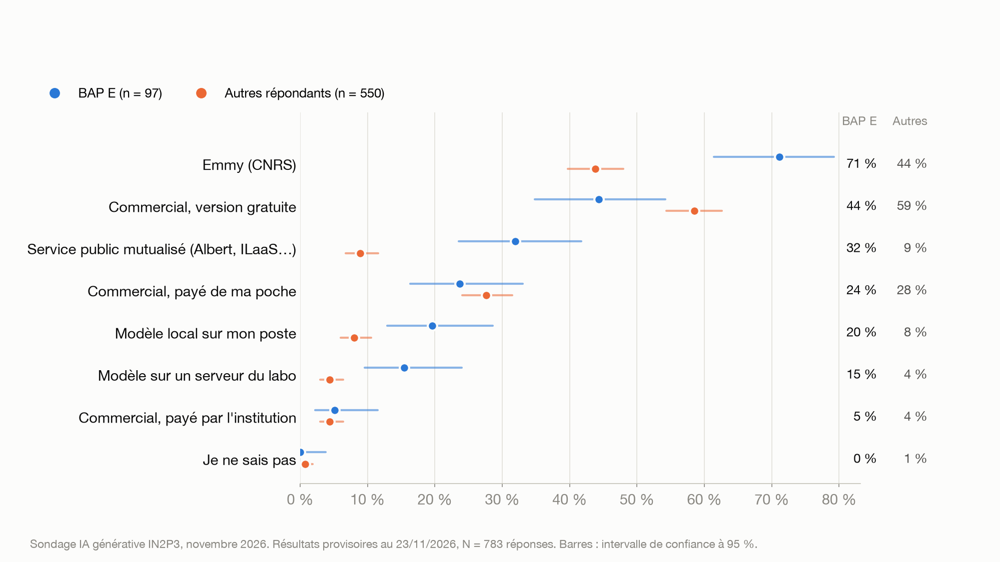
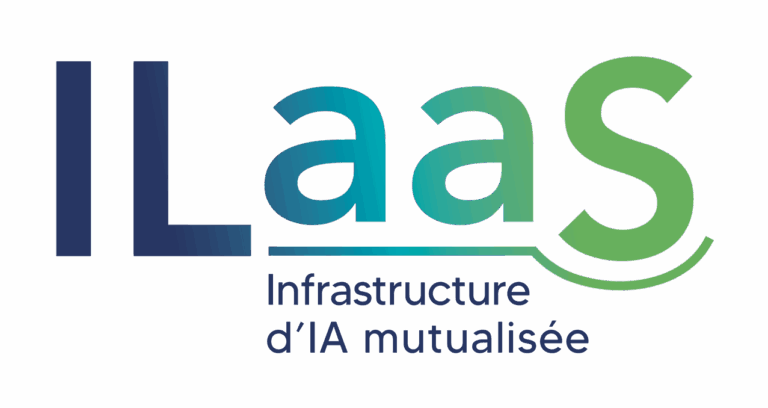

class: cover

# Travaux du GT IA agentique à l'IN2P3

.grade[16es Journées Informatiques IN2P3/IRFU, 23 novembre 2026]

.meta[**Alexandre Boucaud** 
AstroParticule et Cosmologie 
préparé avec Sylvain Caillou (L2IT) et Thomas Vuillaume (LAPP)]

???
Titre et créneau : Indico event 36710, lundi 23 nov. 16 h 55, 20 min.
Viser 15 min de présentation, 5 min de questions : Emmy (S. Deraco) suit à 17 h 15.
Découpage : actualité 1 min, comprendre 3 min, usages et sondage 4 min, GT 3 min, livrables et formations 2 min, cette semaine 1,5 min, transition 0,5 min.

---

# L'IA dans l'actualité récente

<b>6 oct.</b>OpenAI publie plusieurs centaines de résultats mathématiques, dont l'hypothèse « quasi-Riemann ». Accueil partagé : beaucoup de preuves restent à vérifier par des humains.<i><a href="https://github.com/openai/math">github.com/openai/math</a></i>

<b>4 nov.</b>FrontierPhysics : sur 56 tâches conçues par 42 physiciens à partir de leurs propres recherches, aucune configuration d'agent ne réussit plus de 46 exécutions sur 168.<i><a href="https://arxiv.org/abs/2611.06910">arXiv:2611.06910</a></i>

<b>13 nov.</b>Le CNRS expérimente un accès dérogatoire à ChatGPT et Claude pour certaines activités de recherche.<i><a href="https://intranet.cnrs.fr/vie-etablissement/msg/Pages/Utilisation_derogatoire_des_IA_generatives_pour_les_activites_de_recherche_.aspx">Intranet CNRS, utilisation dérogatoire des IA génératives pour la recherche</a></i>

<b>19 nov.</b>936 agents autonomes produisent 936 études en 12 semaines. Certains fondent leur propre revue à relecture par IA, le <em>Journal of Agent Research</em>.<i><a href="https://www.alphaxiv.org/abs/2611.society-ai-scientists">A Society of AI Scientists, alphaXiv, MIT, Stanford</a></i>

<b>20 nov.</b>Levent Alpöge, mathématicien chez Anthropic, affirme avoir démontré l'hypothèse de Riemann avec Claude. Preuve formalisée en Lean, en cours d'examen.<i><a href="https://alpo.ge/remark.pdf">L. Alpöge, note du 20 novembre (alpo.ge/remark.pdf)</a></i>

???
Message : des capacités qui progressent très vite, des limites bien mesurées. Savoir distinguer les deux, c'est l'esprit « sérénité » du GT.
FrontierPhysics est le contrepoint. La dérogation CNRS est le sujet de 18 h 15.

Sources vérifiées le 23/11/2026 :
- OpenAI : annonce du 6 oct. 2026, https://openai.com/index/sharing-ai-progress-in-mathematics/ ; preuves sur https://github.com/openai/math (LaTeX, PDF, bibliothèque Lean, 721 manuscrits en 373 familles, environ 42 % formalisés en Lean). Quanta (19 oct.) parle de « 377 results » ; les décomptes varient selon les sources, d'où « plusieurs centaines ». Quasi-Riemann : demi-plan sans zéro Re(s) > 7/8, 199 pages, vérifié en Lean. P. Sarnak attend que des humains vérifient et comprennent tous les détails ; M. Radziwiłł juge les articles « horribly written ». https://www.quantamagazine.org/ai-proved-the-quasi-riemann-hypothesis-what-happens-now-20261019/
- FrontierPhysics : https://arxiv.org/abs/2611.06910, « Evaluating Agents for End-to-End Physics Research », v1 du 4 nov. 2026. « 56 tasks made by 42 physicists », « 22 models in 26 configurations, no configuration passes more than 46 of its 168 rollouts » (27,4 %).
- CNRS : page intranet https://intranet.cnrs.fr/vie-etablissement/msg/Pages/Utilisation_derogatoire_des_IA_generatives_pour_les_activites_de_recherche_.aspx (lien donné par A. Boucaud). AEF info, 16 nov. 2026 (accès abonnés), entretien avec Christophe Besse, directeur de CNRS Mathématiques. Selon Le Fil IA (23 nov., article rédigé par IA, à prendre avec prudence) : dérogation accordée le 3 nov. par le PDG Thierry Dauxois, abonnements « entreprise » uniquement, pour « certaines activités scientifiques ».
- Society of AI Scientists : https://www.alphaxiv.org/abs/2611.society-ai-scientists, annonce du 19 nov., dépôt du 21 nov. 936 agents répartis dans 35 laboratoires, 936 études avec code et données, du 19 août au 12 nov. La revue (Journal of Agent Research) a été fondée par les agents d'un seul laboratoire, 1 408 relectures par IA. Le nom « CASRAI » du document de préparation est erroné.
- Riemann : Washington Post, 20 nov. 2026 (accès restreint). Source primaire : https://alpo.ge/remark.pdf. L. Alpöge revendique aussi l'hypothèse de Riemann généralisée. Pas de version rédigée lisible, seulement le Lean (plus de 250 000 pages selon la note). Le code compile (A. Sutherland, MIT), la communauté vérifie que l'énoncé Lean est le bon. Ne pas confondre avec le résultat d'Anthropic d'août 2026 sur la proportion de zéros sur la droite critique.

Non retenus à l'écran (non vérifiés) :
- mi-nov. : Anthropic annonce deux problèmes de physique théorique résolus, dont la borne optimale du bootstrap modulaire (Atlantico).
- 4 sept. : des dizaines d'agents Claude formalisent en Lean la preuve complète du dernier théorème de Fermat en 11 jours, 13 millions de lignes, environ 29 500 théorèmes intermédiaires. https://www.anthropic.com/news/formalizing-fermats-last-theorem (vérifié).

---

# De l'IA qui répond à l'IA qui agit

.cols-even[
.col[
#### IA générative

.bilan[
.etape[.t[Modèle de langage] Prédit la suite d'un texte, appris sur de très grands corpus]
.etape[.t[Assistant] Répond à une question, produit texte, code ou image]
.apres[.t[L'humain reprend] Copie, reformule, vérifie, exécute]
]
]
.col[
#### IA agentique

.bilan[
.etape[.t[Même modèle, outillé] Lit et écrit des fichiers, lance des commandes, consulte le web]
.etape[.t[Boucle] Planifie, agit, observe le résultat, corrige]
.apres[.t[L'humain délègue] Spécifie la tâche, puis contrôle le résultat]
]
]
]

.note[**[PyBot (Hugging Face)](https://github.com/huggingface/pybot)** : un chatbot en Python pur, sans poids ni entraînement, écrit par un essaim de plus de 1 000 agents. L'agentique au service d'un logiciel déterministe, auditable et frugal.]

???
Source : document de préparation, partie 1 (puces « modèle de langage », « IA agentique », exemple PyBot).
PyBot : https://github.com/huggingface/pybot, annoncé vers le 16 nov. 2026. Plus de 1 000 agents DeepSeek-V4.1-Flash en une semaine, environ 640 000 lignes de Python, 8 000 PR fusionnées.
Exemples de nos domaines : voir les slides « Cette semaine aux JI » (Chamont, Calvet, Hrivnac).

---

# Changement de paradigme : du « faire » au « faire faire »

.cols-even[
.col[
#### Une évolution du métier

.bilan[
.etape[.t[Spécifier] Décrire précisément ce qui est attendu et le contexte]
.etape[.t[Déléguer] Confier la tâche à un agent outillé]
.apres[.t[Vérifier] Relire, tester, assumer le résultat]
]
]
.col[
#### Les dérives du *vibe coding*

- Code non maîtrisé
- Dette technique
- Sécurité
- Résultats scientifiques fragiles
]
]

.note[Contrairement à ce qu'on pourrait penser ce ne sont pas forcément les développeurs les plus impactés]

???
Message : le métier se déplace vers la spécification, la délégation et la vérification.
Source : document de préparation, partie 2 (« message clé » et « point de vigilance »).
Le détail des dérives est dans le document de la table ronde.

---

# Une échelle des usages (utilisée dans le sondage)

Niveau

Usage

Pour un développeur

1

<b>Interroge</b> un assistant conversationnel et reprend soi-même les réponses

Question à Emmy, Le Chat, ChatGPT, Claude

2

<b>IA intégrée aux outils</b>, avec le contexte de travail, guidée pas à pas

Complétion dans l'IDE

3

<b>Confie une tâche complète</b> à un agent, puis vérifie le résultat

Agent de code sur un dépôt

4

<b>Orchestre</b> un ou plusieurs agents, en continu ou en parallèle

Agents multiples outillés par MCP

???
Message : c'est l'échelle du sondage IN2P3, chacun peut s'y placer.
Source : document de préparation, partie 2 (échelle reprise du sondage, illustrations 2, 3 et 4 pour développeurs).
Rappel : le sondage reste ouvert jusqu'au mercredi 25 novembre.

---

# Sondage : usage courant en fonction du statut

???
Message : aperçu préliminaire, près de 800 réponses au 23 novembre, sondage ouvert jusqu'au mercredi 25.
Source : img/02_b1_adoption_par_groupe.png, résultats provisoires au 23/11/2026, N = 783.
Le document de préparation indiquait 775, les figures du jour donnent 783. Dire « près de 800 ».
Ensemble : −1 = 8 %, 0 = 9 %, 1 = 56 %, 2 = 12 %, 3 = 10 %.
BAP E permanents : 18 % au niveau 3, 9 % au niveau 4.
BAP E (permanents et contractuels) : 25 % délèguent à des agents (niveaux 3 et 4), contre 13 % des autres.
Effectifs faibles : BAP E contractuels, n = 18.
Ne pas détailler : les croisements (métier, employeur, freins) servent au temps d'échange de 18 h 15.

---

# Sondage : moyens d'accès BAP E vs. autres

???
Message : Emmy est l'accès le plus cité par les BAP E. Présentation juste après.
Source : img/05_c3_acces.png, BAP E n = 97, autres n = 550, barres = IC 95 %.
Commercial gratuit : 44 % BAP E, 59 % autres. Payé de sa poche : 24 % et 28 %. Payé par l'institution : 5 % et 4 %.
Ne pas détailler Emmy : renvoyer vers S. Deraco (17 h 15).

---

# Le rôle du groupe de travail : apporter de la lisibilité

Lisibilité<h4>Savoir de quoi on parle</h4>
Explorer les différentes sources et en faire une synthèse fiable.

Besoins<h4>Partir des usages réels</h4>
Mesurer les besoins sur le périmètre de l'institut et les outils utilisables dans le cadre du ministère et du CNRS.

Frugalité<h4>Des usages ciblés</h4>
Montrer que l'IA générative peut se combiner avec la frugalité et des usages très ciblés.

.note[Mandaté par **Rémi Cornat** en octobre 2026. Animé par **Alexandre Boucaud** et **Thomas Vuillaume**, avec la participation de **Sylvain Caillou**. Ouvert à toutes et tous, modèle de fonctionnement en cours de réflexion. **Venez me parler !**]

???
Message : le domaine bouge très vite. Ramener de la sérénité et savoir de quoi on parle.
Source : document de préparation, partie 3. Mandat, animation et ouverture : réponse d'A. Boucaud (23/11).
R. Cornat : direction adjointe technique (intitulé de son exposé à 15 h 00, Indico).

---

# Les objectifs

Objectif

Où on en est

1

Évaluer le besoin sur le périmètre de l'institut

Le sondage et rapport qui suivra

2

Lister les outils utilisables avec les contraintes du ministère et du CNRS, à chaque échelle de besoin

Un guide, en cours de rédaction, qui suit les évolutions

3

Évaluer une solution de LLM mutualisée (initiative ILaaS) utilisable par tous, son infrastructure et ses coûts

Voir slide suivante

4

Évaluer le rapport coût et efficacité d'une solution commerciale, éventuellement européenne

Cf. dérogation CNRS récente

5

Créer un espace de réflexion sur l'évolution des métiers du développement

GDR en construction (stratégie IA IN2P3), temps d'échanges, formations

6

Échanges avec les autres GT métiers (méca, électronique, conception, etc.)

Réunions bi-mensuelles

???
Source : document de préparation, « Objectifs du GT » (1 à 6) et leurs renvois.
« À instruire » et « Ouvert » pour 3 et 5 : le document ne donne pas d'état d'avancement. À confirmer.
Objectif 4 : « type Claude ou Mistral, en se restreignant éventuellement à des ressources européennes ».

---

# Premiers livrables

Sondage<h4>Usages de l'IA générative</h4>
Premiers résultats aujourd'hui. Réponses possibles jusqu'au mercredi 25 novembre.

<a href="https://sondage-ia-generative.in2p3.fr/">sondage-ia-generative.in2p3.fr</a>

Glossaire<h4>ML & IA agentique</h4>
Issu de l'école thématique LaboBots, un vocabulaire commun pour se comprendre.

<a href="https://aissai.pages.in2p3.fr/labobots/ai-glossary/">aissai.pages.in2p3.fr/labobots/ai-glossary</a>

Guide<h4>Outils utilisables / instructions</h4>
En cours de rédaction par Thomas Vuillaume : quels outils, dans quel cadre, pour quel besoin.

<a href="https://machine-learning.pages.in2p3.fr/guide-ia/">machine-learning.pages.in2p3.fr/guide-ia</a>

.note[**Sondage ouvert jusqu'au mercredi 25 novembre** : répondez et partagez autour de vous]

???
Source : document de préparation, partie 4.
URL fournies par A. Boucaud.

---

# Exploration d'une solution mutualisée : ILaaS

.cols-even[
.col[
#### La question

.bilan[
.etape[.t[Le besoin] Un LLM ouvert, hébergé sur une infrastructure publique, pour les **usages courants** de l'institut]
.etape[.t[À évaluer] Les besoins utilisateurs (sondage) Les besoins en infrastructure et les coûts associés]
.apres[.t[Objectif 3 du GT] Évaluer la possibilité de s'appuyer sur l'initiative ILaaS]
]
]
.col[
#### Groupe de travail au CC-IN2P3

- Benoit Delaunay
- Sébastien Gadrat
- Bernard Chambon
- Sylvain Reynaud

]
]

???
Source : document de préparation, objectif 3 (« Évaluer la possibilité de mettre en place une solution de type LLM ouvert (initiative ILaaS), ainsi que les besoins en infrastructure et les coûts associés »). Sous-groupe CC-IN2P3 : A. Boucaud (23/11).
Sondage (figure C3) : un service public mutualisé (Albert, ILaaS) est déjà cité par 32 % des BAP E contre 9 % des autres.
Pas d'état d'avancement ni de calendrier fourni : ne rien annoncer à l'oral sans confirmation.

---

# Se former

.cols-even[
.col[
#### École thématique LaboBots
.muted[Du 29 septembre au 2 octobre 2026, financée par le Centre AISSAI du CNRS]

Initier administrateurs système et développeurs à l'IA générative au service de leur laboratoire : dimensionner un serveur local, choisir un modèle ouvert, monter un RAG, mettre en place un agent.

.muted.lien[Programme : [indico.ijclab.in2p3.fr/event/13661](https://indico.ijclab.in2p3.fr/event/13661/) 
Supports de TP : [gitlab.in2p3.fr/aissai/labobots](https://gitlab.in2p3.fr/aissai/labobots)]
]
.col[
#### ANF IA4Dev
.muted[Du 19 au 22 octobre 2026, orientée agentique]

Le cours *Hands-on Harness* fait reconstruire à la main le « harnais » d'un agent de code (contexte, skills, sous-agents, hooks, sandbox) et mesure ce qui change réellement, sur de nombreuses exécutions plutôt qu'une seule.

.muted.lien[Supports : [github.com/AI-for-dev](https://github.com/AI-for-dev)]
]
]

???
Message : deux formations cet automne, du serveur local à l'agent de code.
Source : document de préparation, « Pour se former ».

---

# Les prochaines étapes du GT

.cols-even[
.col[
#### Au sein du GT

.bilan[
.etape[.t[Sondage] Publier un rapport sur les résultats début 2027]
.etape[.t[Organisation] Structurer le groupe de travail et son mode de fonctionnement]
.apres[.t[Lisibilité dans la durée] Suivre l'évolution des besoins au regard des budgets disponibles et des services à disposition (Albert, Emmy API, ILaaS) et mettre en place une stratégie évolutive pour l'IN2P3]
]
]
.col[
#### Avec les réseaux de formation

.bilan[
.etape[.t[GT Formation de DevLOG] Une journée dédiée, vers mars ou avril 2027]
.apres[.t[Fidle] Une capsule de formation dédiée à l'IA agentique]
]

.muted.lien[[fidle.cnrs.fr](https://fidle.cnrs.fr)]
]
]

.note[Si vous avez envie de participer, venez me rencontrer.]

???
Source : A. Boucaud (23/11), prochaines étapes du GT.
Messages : le sondage donnera lieu à un rapport ; le GT va se structurer ; l'objectif de lisibilité suppose un suivi dans la durée, car besoins, budgets et offres de services évoluent vite.
Journée avec le GT Formation de DevLOG : « vers mars avril », année 2027 déduite. Pas de date fixée.

---

# Cette semaine aux JI : les niveaux 2 à 4 en pratique

Quand

Exposé

Sur l'échelle

Lun. 17&nbsp;h&nbsp;45

Génie logiciel par IA avec OpenCode, EVERSE et CLASSDavid Chamont

Niveau 3, agent de code sur un logiciel scientifique

Mar. 10&nbsp;h&nbsp;00

Refactorisation de la composante IMAG du pipeline ECPIPierre Calvet

Niveau 3, sur du code non public

Mar. 11&nbsp;h&nbsp;45

Interroger les données de Fink avec le système agentique HermesJulius Hrivnac

Niveau 4, agent outillé par une skill

Mer. 10&nbsp;h&nbsp;30

Piscine IA4Dev : développer avec des assistants IAJulien Zoubian

Niveaux 2 à 4, mise en pratique

???
Source : Indico event 36710 (horaires, titres, orateurs) et document de préparation (lien avec l'échelle).
Calvet : refactorisation avec l'IA sur un projet fermé, lien direct avec la question des données.
Hrivnac : cas Rubin.

---

# Cette semaine aux JI : cadre, modèles et frugalité

Quand

Exposé

Lien avec le GT

Lun. 17&nbsp;h&nbsp;15

CNRS Emmy, l'IA généraliste pour les agents du CNRSStéphane Deraco

Accès institutionnel, juste après

Mar. 9&nbsp;h&nbsp;00

Neurochirurgie artificielle pour l'edgeImed Magroune

Modèles spécialisés et frugaux

Mar. 14&nbsp;h&nbsp;45

RI3 : choisir une licence logiciellePhilippe Gauron

Licences et provenance du code généré

Mar. 15&nbsp;h&nbsp;15

MLOps : déploiement continu des modèles d'IAFarid Maman

Industrialisation des modèles

Mer. 18&nbsp;h&nbsp;15

Enjeux sociaux et environnementaux de l'IASiegfried Dubois

Frugalité

???
Source : Indico event 36710 et document de préparation.
Cadre institutionnel déjà posé cet après-midi : DS IA / ML, J. Donini (lun. 15 h 15).

---

# Ce soir, 18 h 15 : IA agentique et nos métiers

Accès<h4>Dérogation CNRS</h4>
Accès dérogatoire à des modèles commerciaux et équité d'accès entre agents.

Données<h4>Souveraineté</h4>
Confidentialité des données et place des modèles ouverts.

Code & Licences<h4>Transparence</h4>
Transparence sur le code généré et sur sa provenance. Quelles licences pour ces logiciels.

???
Message : le temps d'échange prolonge cet exposé.
Source : document de préparation, partie 5 (thèmes : dérogation CNRS, souveraineté, données, modèles ouverts, équité d'accès, transparence sur le code généré).
Créneau : Indico, lun. 18 h 15, « Temps d'échanges libre : IA agentique : situation actuelle, impact sur nos métiers et perspectives » (45 min).
