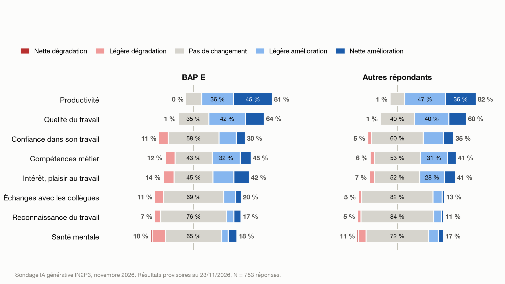
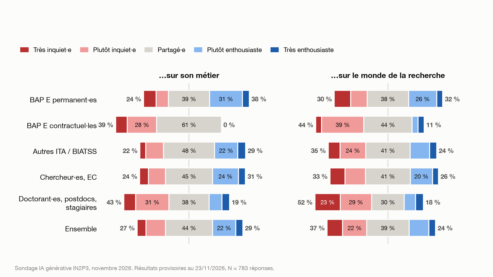
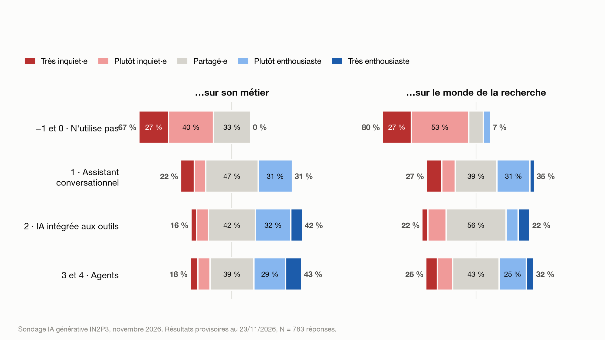
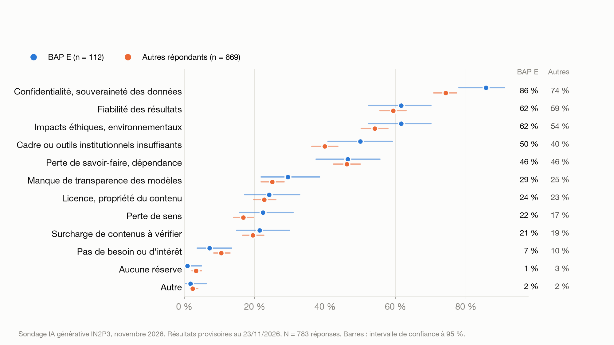
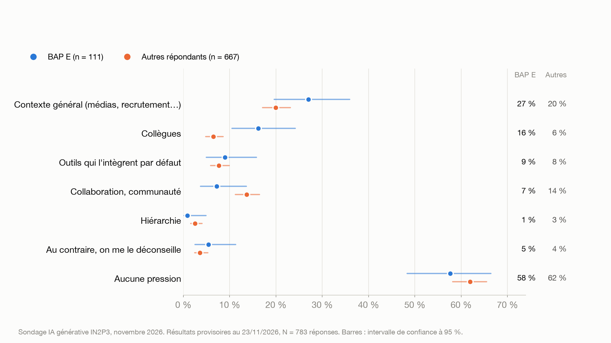
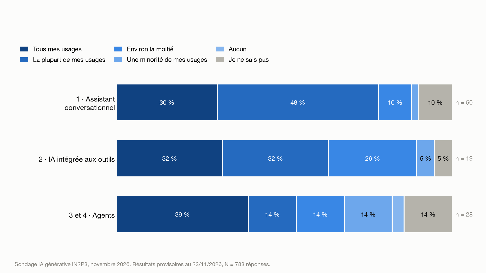
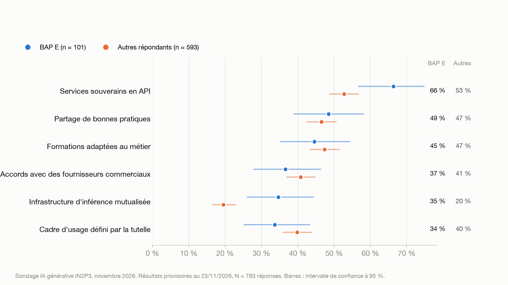

class: cover

# Table ronde

.grade[IA agentique : situation actuelle, impact sur nos métiers et perspectives]

.meta[Quelques résultats du sondage pour lancer la discussion 
Résultats provisoires au 23 novembre 2026]

???
Créneau : Indico, lun. 18 h 15, 45 min.
Toutes les figures comparent la BAP E aux autres répondants. Rappeler les petits effectifs (BAP E contractuels n = 18, agents n = 28).

---

# Plus productifs, mais à quel prix ?

???
Question C6, niveaux 1 à 4. BAP E n = 95 à 97, autres n = 541 à 546.
Productivité : 81 % des BAP E voient une amélioration (autres 82 %). Qualité : 64 % (60 %).
Mais côté BAP E : santé mentale 18 % de dégradation (autres 11 %), compétences métier 12 % (6 %), intérêt au travail 14 % (7 %), échanges avec les collègues 11 % (5 %).
Pour lancer : gagne-t-on du temps au prix du collectif et du sens du métier ?
Source : img/08_c6_effets_sur_le_travail.png, sondage IA générative IN2P3, résultats provisoires au 23/11/2026, N = 783.

---

# Inquiets ou enthousiastes ?

???
Question D4, tous les répondants.
BAP E permanents : 24 % inquiets pour leur métier, 38 % enthousiastes. Pour la recherche : 30 % et 32 %.
BAP E contractuels (n = 18) : 39 % inquiets pour leur métier, 0 % enthousiastes ; 44 % inquiets pour la recherche.
Doctorants, postdocs, stagiaires : 43 % inquiets pour leur métier, 52 % pour la recherche.
Pour lancer : pourquoi les plus précaires et les plus jeunes sont-ils les plus inquiets ?
Source : img/09_d4_inquietude_enthousiasme.png, sondage IA générative IN2P3, résultats provisoires au 23/11/2026, N = 783.

---

# L'inquiétude recule-t-elle avec l'usage ?

???
Question D4 croisée avec B1, BAP E seulement.
Non-utilisateurs (niveaux −1 et 0) : 67 % inquiets pour leur métier, 80 % pour la recherche, 0 % enthousiastes pour le métier.
Utilisateurs d'agents (niveaux 3 et 4) : 18 % inquiets, 43 % enthousiastes pour leur métier.
Attention : corrélation, pas causalité. Les enthousiastes adoptent peut-être davantage.
Pour lancer : l'usage rassure-t-il, ou ne voit-on que ce qu'on choisit de voir ?
Source : img/09b_d4_bape_par_niveau.png, sondage IA générative IN2P3, résultats provisoires au 23/11/2026, N = 783.

---

# Ce qui retient : d'abord les données

???
Question D1, tous les répondants, plusieurs réponses possibles. BAP E n = 112, autres n = 669.
Confidentialité et souveraineté des données : 86 % des BAP E, 74 % des autres. Fiabilité : 62 % et 59 %. Impacts éthiques et environnementaux : 62 % et 54 %. Cadre ou outils institutionnels insuffisants : 50 % et 40 %.
Perte de savoir-faire, dépendance : 46 % des deux côtés.
Pour lancer : la dérogation CNRS répond-elle à la première réserve, ou la renforce-t-elle ?
Source : img/10_d1_reserves.png, sondage IA générative IN2P3, résultats provisoires au 23/11/2026, N = 783.

---

# Une pression qui vient des pairs ?

???
Question D2, tous les répondants. BAP E n = 111, autres n = 667.
58 % des BAP E ne ressentent aucune pression (autres 62 %).
Plus grand écart : la pression des collègues, 16 % des BAP E contre 6 % des autres. Hiérarchie : 1 % et 3 %. Contexte général (médias, recrutement) : 27 % et 20 %.
Pour lancer : la pression vient-elle du terrain plutôt que de la hiérarchie ?
Source : img/11_d2_pression.png, sondage IA générative IN2P3, résultats provisoires au 23/11/2026, N = 783.

---

# Un outil souverain suffit-il ?

???
Question E1 croisée avec B1, BAP E seulement.
Un outil public et souverain suffirait à tout ou presque pour 74 % des niveaux 1 et 2, mais pour 54 % des utilisateurs d'agents (niveaux 3 et 4, n = 28).
Pour lancer : faut-il un outil souverain pour tous, et un accès dérogatoire pour les usages agentiques ? Lien direct avec l'objectif 4 du GT.
Source : img/13b_e1_bape_par_niveau.png, sondage IA générative IN2P3, résultats provisoires au 23/11/2026, N = 783.

---

# Les priorités exprimées

???
Question E3, niveaux 0 à 4, trois choix au maximum. BAP E n = 101, autres n = 593.
Services souverains en API : 66 % des BAP E, 53 % des autres. Partage de bonnes pratiques : 49 % et 47 %. Formations adaptées au métier : 45 % et 47 %.
Plus grand écart : infrastructure d'inférence mutualisée, 35 % contre 20 % (lien avec ILaaS).
Accords avec des fournisseurs commerciaux : 37 % et 41 %.
Pour lancer : par quoi commencer, avec quels moyens ?
Source : img/14_e3_priorites.png, sondage IA générative IN2P3, résultats provisoires au 23/11/2026, N = 783.
---

# Trois thèmes pour la discussion

Accès<h4>Dérogation CNRS</h4>
Accès dérogatoire à des modèles commerciaux et équité d'accès entre agents.

Données<h4>Souveraineté</h4>
Confidentialité des données et place des modèles ouverts.

Code & Licences<h4>Transparence</h4>
Transparence sur le code généré et sur sa provenance. Quelles licences pour ces logiciels.

???
Message : le temps d'échange prolonge cet exposé.
Source : document de préparation, partie 5 (thèmes : dérogation CNRS, souveraineté, données, modèles ouverts, équité d'accès, transparence sur le code généré).
Créneau : Indico, lun. 18 h 15, « Temps d'échanges libre : IA agentique : situation actuelle, impact sur nos métiers et perspectives » (45 min).

